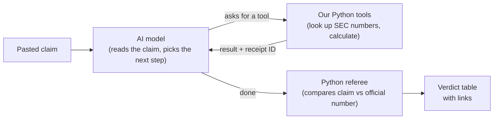

# The plan

## The idea

People post things like *"Company X grew revenue 40% last year, has zero debt, and will be a $5 trillion company by 2028."*
Receipts checks each fact against the company's official SEC filings and shows a **receipt** (the filing and a link) for every number.

It deliberately does **not** pick stocks. Most AI stock projects on GitHub try to, and recent research finds that AI stock-picking
results usually shrink or disappear when tested properly. Checking facts is something we can do honestly, and **measure**.

## How it will work

1. The AI splits the claim into separate statements and writes down how it read each one (which company, which number, which year).
2. The AI can't look anything up by itself. It asks our Python **tools** to fetch official numbers from SEC EDGAR.
   Our code runs the tool and sends the result back, and the AI decides the next step. That loop is what makes it an **agent**.
3. Every number a tool returns gets a receipt ID (R1, R2, ...). The AI refers to numbers by receipt ID; it never types an official number itself.
4. A plain Python **referee**, not the AI, decides SUPPORTED / CONTRADICTED / CAN'T VERIFY using written rules (for example "within 2%").
   Opinions and predictions are NOT CHECKABLE.
5. Python prints the table: each statement, how it was read, the verdict, both numbers side by side, and the link.

**Who does what:** the AI handles messy language and decides what to look up. Plain code fetches the data, does the math and decides the verdict,
because code always gives the same answer and can be tested.

## The steps

Each step is small, ends with something visible on GitHub, and ends with you explaining it back in your own words.

- [x] **Step 1: Get one official number.** `receipts lookup AAPL revenue 2024` prints Apple's official revenue, the dates it covers,
  the filing it came from and a link. *You learn:* what an API and JSON are, what SEC EDGAR, a 10-K and a CIK are, why fiscal years are tricky.
- [ ] **Step 2: More numbers and the referee (still no AI).** About 12 metrics (net income, debt, cash, ...) and `receipts verify`, which
  compares a claimed number with the official one. Automatic tests run on GitHub on every change.
  *You learn:* why math belongs in code, what a tolerance is, why missing must never mean zero.
- [ ] **Step 3: Write the exam before the agent.** About 40 statements with known answers (true, false, tricky, unverifiable, opinions),
  with 10 kept sealed until the very end. *You learn:* what ground truth and a baseline are, and why you write the test first.
- [ ] **Step 4: The agent.** Connect the AI model (DeepSeek, through its API) to our tools with a hand-written loop, so you can explain every line.
  `receipts check "<claim>"` produces the verdict table. Every run is saved so it can be replayed without a key.
  *You learn:* what an agent really is, what tokens are and what they cost, how a system prompt sets rules.
- [ ] **Step 5: Take the exam.** Score the agent, the same AI with no tools (answering from memory), and a do-nothing checker.
  Report accuracy, dangerous errors (false claims marked SUPPORTED), cost and time per claim. *You learn:* how to measure an AI system honestly.
- [ ] **Step 6: Polish and ship.** Fix the most common mistakes, open the sealed exam once, finish the README with the scoreboard,
  and write your own "how it works" and interview notes. *You learn:* error analysis, and explaining the project in two minutes.

## How we'll prove it works

- **The exam is written before the agent exists**, and its answer key is built separately from the tool's own code, so a bug can't mark its own homework.
- **Three contestants take the same exam:** the agent with SEC tools, the same AI with no tools, and a checker that always says CAN'T VERIFY.
- **The worst mistake is counted separately:** calling a false claim SUPPORTED.
- **Every number the AI writes is traced** back to a receipt by a script.
- **Honest limits go in the README:** small self-written exam, annual US numbers only, no prices, no forecasts.

## What it will never do

- Say buy, sell or hold, give price targets, or predict prices.
- Let the AI do arithmetic, type official numbers, or decide verdicts.
- Treat missing data as zero.
- Use real people's posts as examples. Example claims are invented.

## Glossary

| Word | Meaning |
|---|---|
| **SEC** | The US government agency that public companies must file official reports with |
| **EDGAR** | The SEC's free online database of those filings |
| **10-K** | A company's official annual report |
| **CIK** | The SEC's ID number for a company (Apple is 320193) |
| **Fiscal year** | A company's own 12-month accounting year, which often doesn't match the calendar year |
| **XBRL / tag** | The machine-readable labels attached to each number in a filing, like `Revenues` |
| **Restated** | A number the company later corrected or re-presented in a newer report |
| **API** | A website that answers programs instead of people, usually in **JSON** (structured text) |
| **Agent** | An AI in a loop: it picks a tool, our code runs it, it sees the result and decides the next step |
| **Token** | A small piece of text; AI providers charge per token |
| **Baseline** | A simple comparison point that gives a score meaning |
